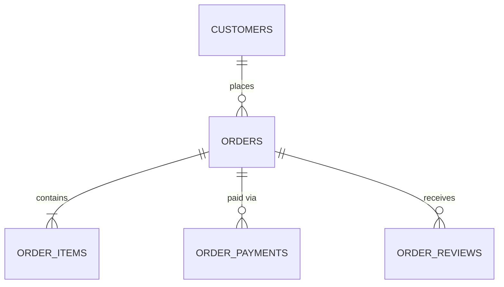

# 📊 E-Commerce Sales Analytics: End-to-End Data Analytics Project

An end-to-end **Data Analytics & Data Science** project built using **MySQL, SQL, Python, Statistics, Machine Learning, Time Series Forecasting, and Power BI** to analyze e-commerce sales, profit, customers, products, discounts, and returns. This project covers the complete analytics workflow, from data storage and extraction to cleaning, exploratory data analysis, hypothesis testing, profit prediction, sales forecasting, and interactive dashboard development.

## 🚀 Project Overview

An e-commerce company has thousands of customer orders, products, and sales transactions. This project transforms that raw data into actionable business insights by integrating SQL, Python, and Power BI. The analysis focuses on what drives sales, which products and customers are most valuable, whether discounts help the business, and what future demand will look like.

## ❓ Business Problem

Management wants to know:

- What is driving sales?
- Which products are the most profitable?
- Who are the most valuable customers?
- Is discounting actually helping the business?
- What will future sales look like?

## 🎯 Business Objectives

- Analyze revenue and profit performance.
- Identify top products, categories, and high-value customers.
- Measure the impact of discounts on profit and Average Order Value.
- Analyze return patterns.
- Predict order-level profit using machine learning.
- Forecast sales demand for the next 6 months.
- Build an interactive Power BI dashboard for decision-making.

## 🧾 Business Questions

1. How much revenue and profit did we generate?
2. Which products and categories perform best?
3. Which customers generate the most revenue?
4. Does discount impact profitability?
5. Does discount significantly affect Average Order Value?
6. Can we predict order-level profit?
7. Can we forecast future sales?

## 📂 Dataset

- **Database:** `ecommerce_analytics` (MySQL)
- **Tables:** Customers, Products, Orders, OrderDetails, Returns

### Database Structure

- Customers → Orders (one-to-many)
- Orders → OrderDetails (one-to-many)
- Products → OrderDetails (one-to-many)
- Orders → Returns (one-to-many)

## ER Diagram



## 🛠️ Tech Stack

- **Database:** MySQL
- **Query Language:** SQL
- **Programming:** Python
- **Libraries:** Pandas, NumPy, Matplotlib, Seaborn
- **Statistics:** SciPy (t-test, p-value, significance level)
- **Machine Learning & Forecasting:** Scikit-learn, Time Series Forecasting
- **Visualization & Dashboard:** Power BI
- **Version Control:** Git & GitHub

## 📌 Project Workflow

1. Store and manage raw data in MySQL
2. Extract data using SQL (JOINs, aggregations)
3. Connect MySQL with Python
4. Data cleaning (missing values, duplicates, data types)
5. Exploratory Data Analysis (EDA)
6. Statistical analysis
7. Hypothesis testing
8. Build prediction models (order profit)
9. Forecast future sales (next 6 months)
10. Build Power BI dashboard
11. Business insights & recommendations

## 📈 Key Features

- SQL queries using JOINs, aggregations, and grouping
- Data cleaning and transformation with Pandas
- Missing value and duplicate handling
- EDA: monthly sales trends, category and regional performance, customer behaviour, discount patterns, profit distribution, outliers, correlations
- Descriptive statistics: mean, median, mode, variance, standard deviation, quartiles, percentiles, correlation, distribution
- Hypothesis testing with t-test, p-value, and significance level
- Machine learning model evaluated with MAE, RMSE, and R² score
- Time series sales forecasting
- Interactive Power BI dashboard with KPIs

## 🧪 Hypothesis Testing

**Question:** Does discount significantly affect Average Order Value?

- **H₀:** Discount has no significant effect on Average Order Value.
- **H₁:** Discount has a significant effect on Average Order Value.
- **Method:** Two-sample t-test at 5% significance level (α = 0.05)
- **Result:** t-statistic = 13.87, p-value = 1.8665022824881592e-30 → reject H₀

## 🤖 Profit Prediction Model

- **Goal:** Predict order profit
- **Features:** Quantity, Unit Price, Discount, Category, Region, Customer Information
- **Models tried:** Random Forest Regressor
- **Best model performance:** MAE = 74.62, RMSE = 211.25, R² = 0.99

## 🔮 Sales Forecasting

- **Input:** Historical monthly sales
- **Approach:** Time series analysis → forecasting model
- **Forecast horizon:** Next 6 months
- **Outcome:** Sales generated 153.31M in revenue across 4.39K orders at a 34.26% profit margin,
- remaining stable overall with a peak in July before plateauing ~35–40% lower from August to December.

## 📊 Dashboard Highlights

### Executive Overview
- Total Revenue
- Total Profit
- Total Orders
- Profit Margin %
- Average Order Value (AOV)

### Product Analytics
- Top 10 Products
  
### Sales Analytics
- Monthly Revenue Trend
- Regional Performance
- Revenue by Category
- Return Reasons

### Forecasting
- 6-Month Sales Forecast

## 💡 Business Insights

1. Total revenue and profit generated:
 ◉ Generated 153.31M in total revenue and 52.52M in total profit across 4.39K orders,
   achieving an average order value of 34.95K and a 34.26% overall profit margin.

2. Top 3 categories / products and their contribution:
   ◉ Categories: Home leads at 48.11M (~31.4% of total revenue), followed by Electronics at 45.5M (~29.7%) and Fashion at 34.92M (~22.8%).
   ◉ Products: Bedsheet leads at 11M, followed by Power Bank, Hair Dryer, and Mixer Grinder tied at 9M each.   

3. Top customers or regions driving revenue:
   ◉ South (40.47M), West (37.54M), and North (36.24M) drive the majority of sales evenly, while East lags significantly at 14.29M.
   
4. Effect of discounts on profit:
   ◉ Not visible on the current dashboard view (insert your notebook/SQL analysis finding.

5. Hypothesis test conclusion:
   ◉ Not visible on the current dashboard view (insert your statistical test result.

6. Most important factors in predicting profit:
   ◉ Based on the metrics, Sales Volume / Revenue, Product Category (Home & Electronics), Region (South/West/North),
   and Return Rates (9.4M lost across top return reasons) are primary drivers of net profit.
   
7. Forecast summary and recommendation:
  ◉  Monthly sales peaked in July (~18M) before stabilizing at a lower plateau (~10M–11M/month) from August through December.
   To restore growth, target marketing and logistics expansion in the underperforming East region (14.29M) and
   reduce the 9.4M return leakage by addressing product quality (Not Satisfied: 2.2M), packaging (Damaged: 2.0M), and shipping speed (Late Delivery: 1.9M).

## 📷 Dashboard Preview


## 📁 Repository Structure

```

ecommerce-sales-analytics/
├── data/            # CSV files (or sample data)
├── sql/             # table creation and analysis queries
├── notebooks/       # EDA, statistics, ML, forecasting notebooks
├── powerbi/         # .pbix dashboard file
├── images/          # dashboard and chart screenshots
├── requirements.txt
└── README.md
```

## ▶️ How to Run

1. Create the tables using the scripts in `sql/` and load the CSV files into MySQL.
2. Install dependencies: `pip install -r requirements.txt`
3. Update the database connection details in the notebook (use your own credentials, never commit passwords).
4. Run the notebooks in order.
5. Open the `.pbix` file in Power BI Desktop.

## 📌 Future Enhancements

- Deploy the dashboard using Power BI Service
- Automate the data refresh pipeline
- Try advanced forecasting models (Prophet, ARIMA, LSTM)
- Implement Row-Level Security (RLS)
- Add drill-through reports

## 👨‍💻 Author

Priyadarshani Suresh Shingade

- LinkedIn: www.linkedin.com/in/priyadarshani-shingade-228626354
- GitHub:  https://github.com/priyashingade2912

